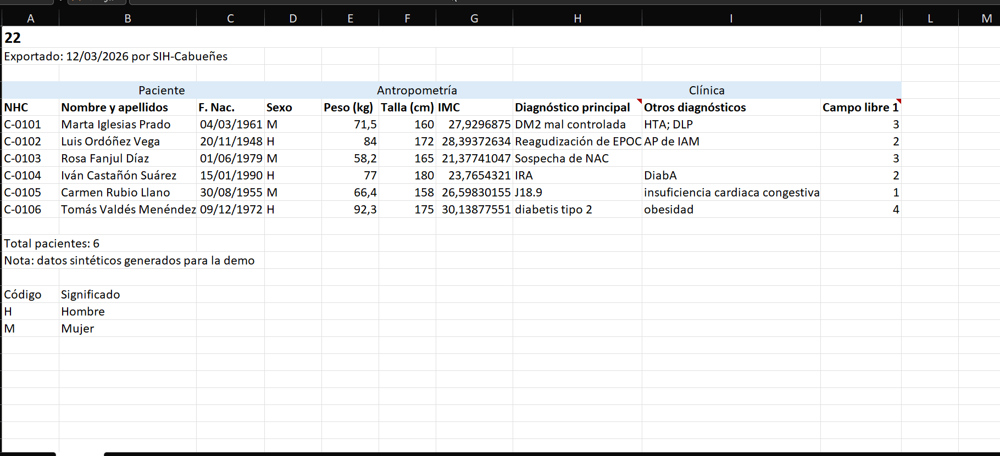

<p align="center">
  <picture>
    <source media="(prefers-color-scheme: dark)" srcset="docs/media/logo-dark.png">
    
  </picture>
</p>

<p align="center">
  <a href="https://github.com/iyangarcia/multi-bridge/actions/workflows/tests.yml"></a>
  <a href="LICENSE"></a>
</p>

# Multi Bridge

Multi Bridge converts data from one format to another. You give it a source file and one example
of the output you want. It works out where each output field comes from, you check and approve
the mapping, and from then on files with the same structure are converted automatically.



**[Try it in your browser](https://iyangarcia.github.io/multi-bridge/)**, no install needed. The
demo runs entirely on your computer, so your files are never uploaded anywhere.

It reads CSV, Excel, JSON, XML, HL7 v2 and FHIR, and writes all of them except HL7 v2.

## How it works

1. **Read.** The source file is turned into simple rows of named columns, whatever its format.
   Hand-made Excel sheets are handled too: title rows, merged headers, comments, footers.
2. **Propose.** For each field of the output, it looks for the column that holds it: by name,
   by where a standard puts it, or by what the values look like. It also picks the conversions
   (date formats, units, decimal commas, codes such as `H`/`M` for sex).
3. **Review.** Every field shows its source, the reason for the choice, and a before/after
   preview. Anything uncertain is left for you to decide instead of guessed.
4. **Convert.** The approved mapping is saved as a small JSON recipe, signed with the reviewer's
   name. A file with the same structure is converted with it directly, and every value is checked
   against the destination's rules.

[docs/HOW_IT_WORKS.md](docs/HOW_IT_WORKS.md) explains how each field is decided, with real examples.

## Run it locally

Requires Python 3.10 or later.

```bash
git clone https://github.com/iyangarcia/multi-bridge.git
cd multi-bridge
python -m venv .venv
.venv/Scripts/pip install -e ".[dev]"     # macOS/Linux: .venv/bin/pip
multibridge serve                         # then open http://127.0.0.1:8766
```

The web app only listens on your own machine, and has an ES/EN switch in the top bar. The
command line answers in Spanish:

```bash
multibridge inspect examples/hospital_c_messy.xlsx
multibridge map examples/hospital_c_messy.xlsx --model rules --expected expected/paciente_resumen_fhir.example.json
multibridge approve recipes/drafts/hospital_c_messy.json --by "Your name" --expected expected/paciente_resumen_fhir.example.json
pytest
```

**Optional: a local language model.** With [Ollama](https://ollama.com) running and
`ollama pull qwen3:8b`, the proposals are made by the model instead of the rules. It runs on your
machine and only sees the structure of the file and masked samples (`FERNANDEZ` becomes
`XXXXXXXXX`), never the real values. Its answers go through the same checks as the rules. If
Ollama isn't running, the rules are used.

## Destinations

A destination is an example of the output in its own format: a JSON record, a CSV with one row,
an XML document, a FHIR Bundle. The output copies its structure and style. An optional
`<name>.rules.json` adds what an example can't show, such as required fields, allowed values, or
grouping several rows into one item (order lines into orders).

If you don't have an example, pick a format (JSON, CSV, Excel or XML) and either take every
column of the source or list the fields yourself. These field lists can be saved and edited on
the "Output formats" page.

## Project layout

| Folder | Contents |
|---|---|
| `multibridge/` | the Python package: readers and writers per format (`formats/`), domain knowledge (`packs/`), the proposer, the engine, the local web API |
| `web/` | the review web app |
| `expected/` | destination examples |
| `examples/` | synthetic source files to try it with |
| `evalset/`, `scripts/` | generated test files with known answers, and the measurement scripts |
| `tests/` | the test suite |
| `docs/` | how it works, data protection notes, measurements |

Formats are plug-ins: a new format means one reader, writer and checker, not one converter per
pair. Domain knowledge lives in packs. Healthcare is the first one: patient vocabulary, HL7 and
FHIR positions, ICD-10 and LOINC codes. Without a pack it matches on column names alone.

## Data and privacy

Everything in `examples/` is synthetic, invented for testing. Nothing is sent outside your
machine: the web app listens on localhost only, and the browser demo runs in the page. Columns
holding personal data are detected and flagged, and every mapping needs a person's approval.
[docs/COMPLIANCE.md](docs/COMPLIANCE.md) maps this to GDPR and Spanish health data law.

## Limitations

- The ICD-10 list is a small demo set (about 30 categories), not the official release.
- HL7 v2 can be read but not written yet.
- The FHIR checker covers structure and references; it is not the official validator.
- The confidence figures were measured on generated files ([docs/CALIBRATION.md](docs/CALIBRATION.md)).
  Real exports may be harder.
- Transforms can't be edited in the web app yet; edit the recipe JSON instead.

## Background

The project started at Hackathon TalentUO 2026, on a challenge set by Pragmatech AI Solutions:
connect one clinical application to three hospitals that send HL7 v2, FHIR and Excel, without
writing a separate integration for each. The web app is based on the one our team (Grupo 5) built
there.

## License

[MIT](LICENSE)
